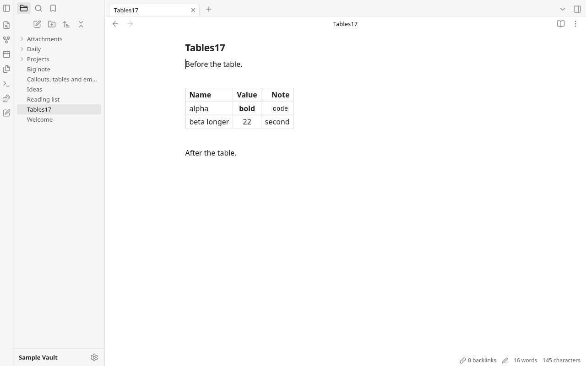
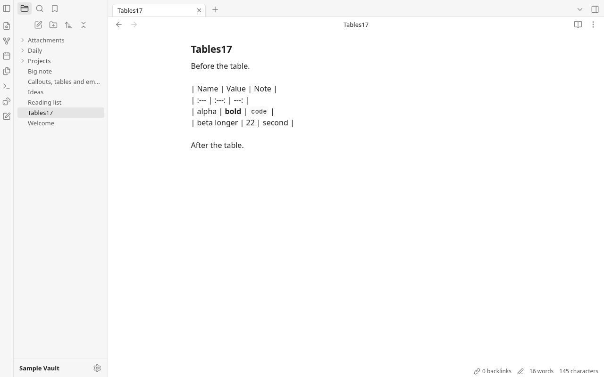
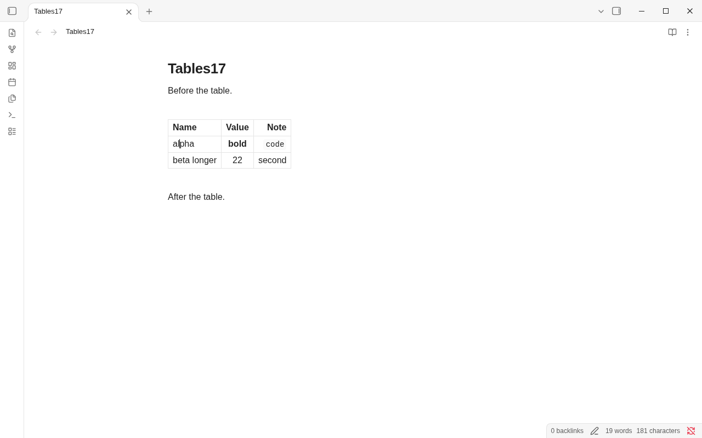
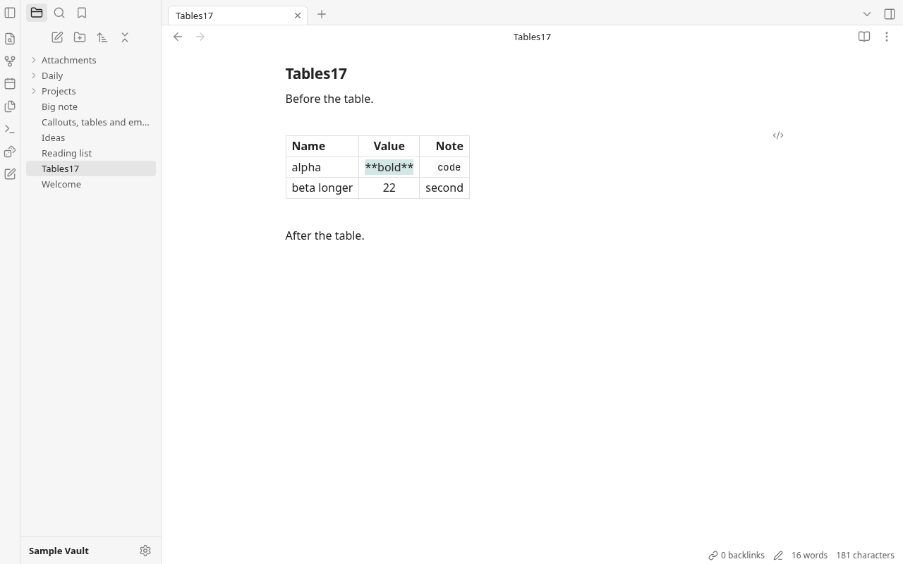
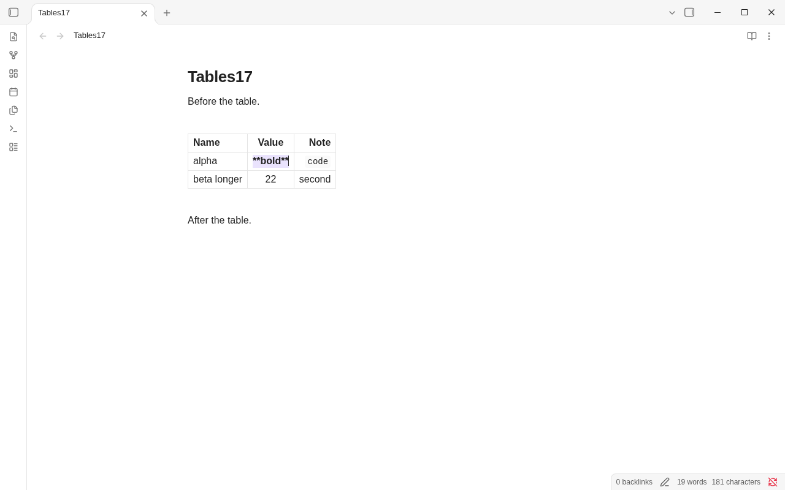

# Round 17 — Part A: in-place table editing

Baseline: `bae3fcb`; branch `rebuild/r17-codex`. Part A only.
Implementation: `b989f7b`; regression tests: `e57eeb7`; nested editor margin fix:
`541ca85`. Part B is deferred as requested.

## What changed

Live Preview keeps the table drawn while a cell is edited. Its header,
borders and alignment remain; other cells retain their rendered inline
markdown. Clicking places the caret by pointer position, and dragging
selects cell text. Tab/Shift+Tab step between cells; Enter moves down;
Tab at the last cell and Enter at the last row append a row. Shift+Enter
retains the existing ` ` insertion. Arrows cross cell edges and Escape
or an outside press ends cell editing, including tables at document edges.

The existing context menu, row/column operations, sorting and table edit
control remain available. Ordinary task checkboxes still tick. Formatting
commands recognize the focused cell as part of the note editor. Source mode
remains raw and Reading view remains read-only. Tables drawn inside a
callout still enter that callout's source editor, as before.

## Implementation choice

Reuse `TableWidget` in `editor/tables.ts` and its existing renderer, parser,
formatter and operations. The block decoration now stays present when the
selection enters a table. Exactly one nested CodeMirror view edits the
active cell; its changes and selection map to that cell's document range.
The note owns all undo history. Widget DOM survives document changes, and
ordinary typing leaves other cells' DOM alone. No new module, abstraction
layer, dependency, backend command or permission was added.

Cell input escapes delimiter pipes, including pipes exposed by deleting an
escape, and converts pasted line breaks to ` `. Normal typing changes
only that cell's source range, retaining surrounding source padding and
alignment bytes. Navigation and structural actions continue using the
existing `formatTable()` output, including its whole-table padding behavior.
Whitespace typed inside the active cell remains editable until departure;
entering a missing cell materializes the row with the existing formatter.

## Observation and differences from Obsidian

Fresh Obsidian 1.14.4, default light theme, and Grove used the same
`Tables17.md` fixture at 1280×800 and device scale 1. Obsidian ran with
`--ozone-platform=headless`, a fresh scratch HOME/XDG tree and vault under
`/tmp`, inside a network namespace. Grove used Vite, its in-memory mock
vault and a private headless Chromium profile. No visible app window or
real vault was opened.

Both keep the table drawn, reveal the active cell's source and navigate
with Tab and Enter. Obsidian syntax-highlights the active cell's raw
markdown; Grove's active cell currently uses plain text with the cell's
header/alignment style. Existing table sizing, surrounding spacing and the
single hover edit control remain Grove's prior implementation; this round
does not recreate Obsidian's additional hover row/column handles. In both
apps revealing `**bold**` can widen that column.

Before: the initial rendered table, then a real press/release in `alpha`
that removed the table and showed pipe source:

After: Grove (left) and Obsidian (right), editing `alpha` on the same note:

Active inline markdown, Grove (left) and Obsidian (right):

Additional captures: [Obsidian before editing](round17-shots/obsidian-before.png),
[Grove context menu](round17-shots/grove-menu.png).

## Validation

All required gates pass:

- `npm run build`.
- `npm test`: **176 tests, 33 files**, including new navigation,
  escaping/paste and shared undo/redo coverage.
- `npm run audit:offline`: source, bundle, CSP, capabilities and dependencies.
- `cargo build` and `cargo test`: **32 Rust tests**.
- `git diff --check`.

Headless CDP interaction checks used actual pointer movement, button presses
and releases, plus held-button motion for drag selection. No scripted DOM
clicks were used. The table control and menu items were hovered before
pressing; Row and Column submenus opened by pointer hover. Checks covered:

- Editing without removing the table; spaces and escaped pipes; undo and
  redo with the caret/focus restored to the edited cell.
- Tab/Shift+Tab, Enter, added rows, horizontal/vertical arrows and Escape.
- Native drag selection inside a cell; clicking outside, including onto a
  checkbox; Ctrl+A, word deletion and the existing bold shortcut.
- Duplicate row/column through hovered menus, then undo; table edit control.
- Compact/optional outer pipes, missing cells, a table at EOF, callout
  tables, Source mode and Reading view.

Performance probe: 70 CDP text insertions per case, alternating the baseline
and implementation twice, using a 5,000-line (~309 KB) note and a 40-row
table. The scratch baseline was extracted **inside this worktree's ignored
node_modules** and served separately; no other checkout was modified.
Big-note medians were 29.4–29.6 ms before and 29.9–31.7 ms after, including
CDP round trips and existing document work. No document walk was added
outside tables. The 40-row probe measured 0.9–1.0 ms median before versus
1.3 ms after; p95 was about 1.2–2.3 ms before and 1.9–2.9 ms after.
There was no visible typing lag, but **the strict numerical “no slower”
target is not met by this probe**: the nested view adds roughly 0.3–0.4 ms
per insertion. This is a recorded limitation, not a claimed speedup.
A later Rust rerun briefly failed because scratch browser profiles exhausted
the temporary-file quota. Removing only this round's profiles restored all
32 passing tests; no Rust code was changed.
Harnesses and timing output remain in ignored `rebuild/app/node_modules/.round17/`.
No Tauri app was launched; WebKitGTK interaction/performance was not tested.

## Net tracked app lines

Brief's newline counting convention under `rebuild/app`, excluding `/gen/`:

- TypeScript production: **18,510 → 18,707 (+197)**.
- TypeScript tests: **2,306 → 2,356 (+50)**.
- TypeScript total: **20,816 → 21,063 (+247)**.
- CSS: **3,541 → 3,564 (+23)**.
- Rust: **3,104 → 3,104 (0)**.
- Total app: **27,461 → 27,731 (+270)**.

Markdown notes and PNG captures are excluded. No new app module was added;
`tables.ts` remains below 500 lines. Commits are local only; nothing was
pushed or merged.
