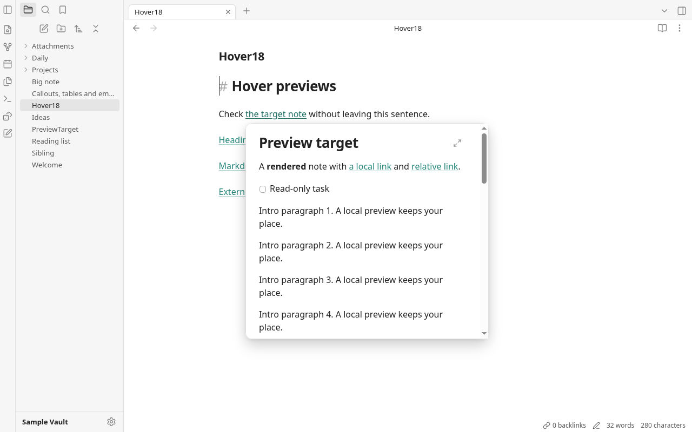
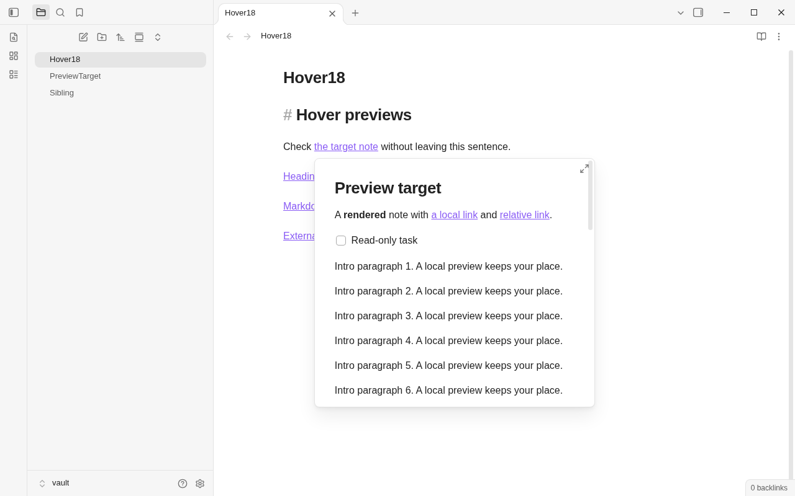
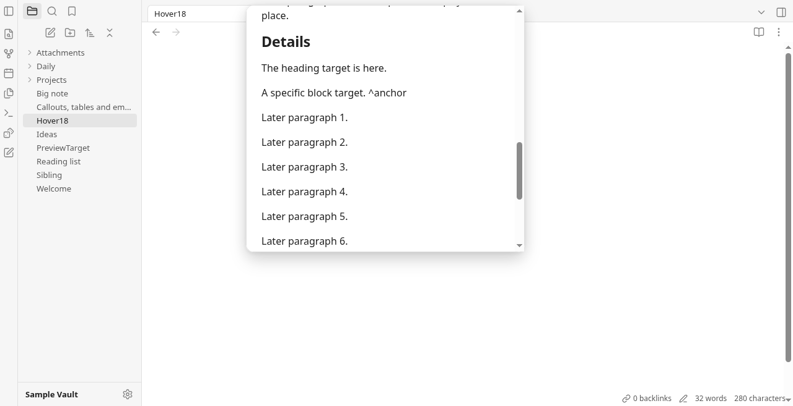
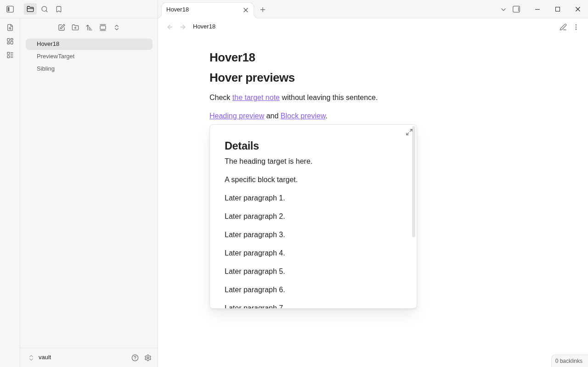

# Round 18 — Part A: link hover previews

Branch: `rebuild/r18-codex`. Baseline: `a9f28fd`. Implementation: `99b70f4`.
Part A only; Part B is deferred until requested. Commits are local only.

## What changed

Ctrl+hover in Live Preview and Source mode opens an internal note preview
after 350 ms; macOS uses Cmd. Reading view uses plain hover. Backlinks and
Search result titles and rows support Ctrl/Cmd+hover too. Wikilinks and
Markdown note links retain their heading/block targets. Missing notes show
“not created yet”; external URLs never preview or load.

The preview reuses `NoteEmbedWidget` and the existing rendered Markdown,
with tasks disabled. It shows the full note and scrolls to a heading or
block using the existing embed-section lookup. Rendered lines and blocks
carry their source line for that scroll. A 450×400 scrollable popup uses the
shared radius, border and shadow, goes below or above its link, and clamps
inside the viewport. Moving into it preserves it; leaving both surfaces
closes it after 180 ms. Escape, typing, source-note scrolling, navigation,
window blur and resizing dismiss it. Real clicks on links inside the
preview navigate from the previewed note, including relative Markdown links.
Only one popup exists at a time, and closing releases widgets and watches.

New production module: `src/shell/hoverPreview.ts` (136 lines). One document
hover controller serves editors and sidebar results without adding a
plugin to every editor. It creates a detached, read-only CodeMirror view
only when the delayed hover opens, as the existing widget's rendering
context. Dismissal listeners and the workspace subscription exist only
while a hover is pending/open. Ordinary typing installs no preview work;
there is no document-update extension, scan, file read or new dependency.
The existing `linkAt()` now recognizes internal Markdown destinations
when the pointer is on the URL itself, and same-note anchors.
No backend command, permission or CSP change was needed.

## Observation and screenshots

Obsidian 1.14.4, default light theme, and Grove used the same three scratch
notes (`Hover18.md`, `PreviewTarget.md`, `Sibling.md`) at 1280×800, scale 1.
Grove ran in headless Chromium with a private profile and its in-memory
mock backend. Obsidian ran with `--ozone-platform=headless`, private
HOME/XDG folders and a fixture vault under this worktree's ignored scratch
directory, inside a separate network namespace. Only rendered UI/DOM was
observed; no Obsidian source, styles or assets were copied. No visible app
window, Tauri window or owner's real vault was opened.

Grove (left) and Obsidian (right), Ctrl+hover over the same link:

Heading targets, Grove (left) and Obsidian (right):

Obsidian's popup measured 452×402 including its border; Grove's is 450×400.
Grove retains its existing font, link color and rendered block styling,
so line wrapping differs. Obsidian restricts this heading preview to its
section; Grove keeps the full note and scrolls to the target, as requested.
Grove's preview is explicitly read-only, including task checkboxes. It has
no nested hover popup. Cmd behavior has unit coverage, not a macOS run;
WebKitGTK interaction was not tested.

Additional captures: [Source mode](round18-shots/grove-source.png),
[missing note](round18-shots/grove-missing.png),
[Backlinks](round18-shots/grove-backlinks.png), and
[800×520 viewport](round18-shots/grove-constrained.png).

## Verification

Required gates passed:

- `npm run build` and `npm run audit:offline` (including its rebuild).
- `npm test`: **195 tests in 38 files**. Added link target/resolution tests
  for headings, blocks, missing notes, Markdown destinations, code and
  external URLs; fake-clock tests cover 350/180 ms timing, cancellation,
  reentry, single opening, Escape and macOS Cmd.
- `cargo build` and `cargo test`: **32 Rust tests**.
- `git diff --check`.

Headless CDP checks used actual mouse moves with Ctrl held, mouse
press/release and wheel input, never DOM `.click()`. All **24 checks**
passed: plain-hover gating, early/open timing, entry into the popup,
scrolling it, delayed departure, canceled/reentered hover, Escape,
heading/block scroll positions, missing/external/Markdown links,
a real link click and navigation, Reading/Source modes, typing and
source scrolling, Backlinks, Search and viewport bounds.
Obsidian's screenshots were also triggered with actual pointer input.

Final performance probe alternated baseline/current twice, with fresh
browser storage and 70 CDP insertions per case. A 5,000-line (~363 KB)
note measured median **33.3–33.4 ms before / 33.1–33.4 ms after**, p95
**34.0–35.1 / 34.1–35.3 ms**. A real mouse press entered a cell in a
40-row table; its medians were **0.94–0.98 / 0.89–0.90 ms**, p95
**1.23–1.24 / 1.15–1.17 ms**. These CDP-inclusive samples show no material
new typing regression; the small differences do not establish a speedup.
The baseline was extracted only inside this worktree's ignored directories.
Harnesses, fixtures and final timings remain in ignored
`rebuild/app/node_modules/.round18/` (`probe.mjs`, `check.mjs`, `panes.mjs`,
`obsidian.mjs`, `perf.mjs`, `perf.json`).

## Net tracked app lines

Task's tracked-file/newline convention under `rebuild/app`, excluding
`/gen/`, notes and screenshots, compared with `a9f28fd`:

- TypeScript production: **18,863 → 19,017 (+154)**.
- TypeScript tests: **2,585 → 2,708 (+123)**.
- TypeScript total: **21,448 → 21,725 (+277)**.
- CSS: **3,572 → 3,606 (+34)**.
- Rust: **3,104 → 3,104 (0)**.
- Total app: **28,124 → 28,435 (+311)**.

No files exceed the round's size ceiling. Nothing was pushed or merged.
