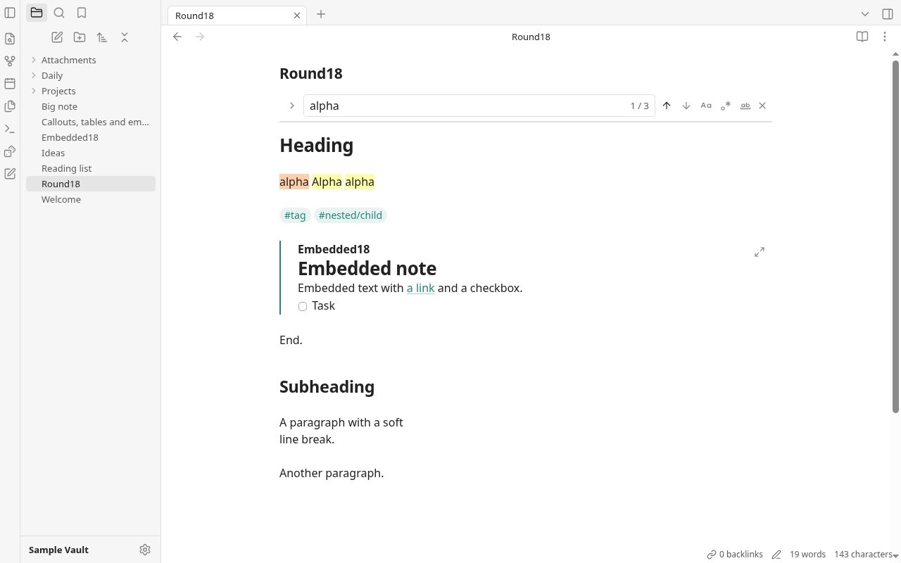

# Round 18 — Part A: link hover previews

Branch: `rebuild/r18-codex`. Baseline: `a9f28fd`. Implementation: `99b70f4`.
Part A only; Part B is deferred until requested. Commits are local only.

## What changed

Ctrl+hover in Live Preview and Source mode opens an internal note preview
after 350 ms; macOS uses Cmd. Reading view uses plain hover. Backlinks and
Search result titles and rows support Ctrl/Cmd+hover too. Wikilinks and
Markdown note links retain their heading/block targets. Missing notes show
“not created yet”; external URLs never preview or load.

The preview reuses `NoteEmbedWidget` and the existing rendered Markdown,
with tasks disabled. It shows the full note and scrolls to a heading or
block using the existing embed-section lookup. Rendered lines and blocks
carry their source line for that scroll. A 450×400 scrollable popup uses the
shared radius, border and shadow, goes below or above its link, and clamps
inside the viewport. Moving into it preserves it; leaving both surfaces
closes it after 180 ms. Escape, typing, source-note scrolling, navigation,
window blur and resizing dismiss it. Real clicks on links inside the
preview navigate from the previewed note, including relative Markdown links.
Only one popup exists at a time, and closing releases widgets and watches.

New production module: `src/shell/hoverPreview.ts` (136 lines). One document
hover controller serves editors and sidebar results without adding a
plugin to every editor. It creates a detached, read-only CodeMirror view
only when the delayed hover opens, as the existing widget's rendering
context. Dismissal listeners and the workspace subscription exist only
while a hover is pending/open. Ordinary typing installs no preview work;
there is no document-update extension, scan, file read or new dependency.
The existing `linkAt()` now recognizes internal Markdown destinations
when the pointer is on the URL itself, and same-note anchors.
No backend command, permission or CSP change was needed.

## Observation and screenshots

Obsidian 1.14.4, default light theme, and Grove used the same three scratch
notes (`Hover18.md`, `PreviewTarget.md`, `Sibling.md`) at 1280×800, scale 1.
Grove ran in headless Chromium with a private profile and its in-memory
mock backend. Obsidian ran with `--ozone-platform=headless`, private
HOME/XDG folders and a fixture vault under this worktree's ignored scratch
directory, inside a separate network namespace. Only rendered UI/DOM was
observed; no Obsidian source, styles or assets were copied. No visible app
window, Tauri window or owner's real vault was opened.

Grove (left) and Obsidian (right), Ctrl+hover over the same link:

Heading targets, Grove (left) and Obsidian (right):

Obsidian's popup measured 452×402 including its border; Grove's is 450×400.
Grove retains its existing font, link color and rendered block styling,
so line wrapping differs. Obsidian restricts this heading preview to its
section; Grove keeps the full note and scrolls to the target, as requested.
Grove's preview is explicitly read-only, including task checkboxes. It has
no nested hover popup. Cmd behavior has unit coverage, not a macOS run;
WebKitGTK interaction was not tested.

Additional captures: [Source mode](round18-shots/grove-source.png),
[missing note](round18-shots/grove-missing.png),
[Backlinks](round18-shots/grove-backlinks.png), and
[800×520 viewport](round18-shots/grove-constrained.png).

## Verification

Required gates passed:

- `npm run build` and `npm run audit:offline` (including its rebuild).
- `npm test`: **195 tests in 38 files**. Added link target/resolution tests
  for headings, blocks, missing notes, Markdown destinations, code and
  external URLs; fake-clock tests cover 350/180 ms timing, cancellation,
  reentry, single opening, Escape and macOS Cmd.
- `cargo build` and `cargo test`: **32 Rust tests**.
- `git diff --check`.

Headless CDP checks used actual mouse moves with Ctrl held, mouse
press/release and wheel input, never DOM `.click()`. All **24 checks**
passed: plain-hover gating, early/open timing, entry into the popup,
scrolling it, delayed departure, canceled/reentered hover, Escape,
heading/block scroll positions, missing/external/Markdown links,
a real link click and navigation, Reading/Source modes, typing and
source scrolling, Backlinks, Search and viewport bounds.
Obsidian's screenshots were also triggered with actual pointer input.

Final performance probe alternated baseline/current twice, with fresh
browser storage and 70 CDP insertions per case. A 5,000-line (~363 KB)
note measured median **33.3–33.4 ms before / 33.1–33.4 ms after**, p95
**34.0–35.1 / 34.1–35.3 ms**. A real mouse press entered a cell in a
40-row table; its medians were **0.94–0.98 / 0.89–0.90 ms**, p95
**1.23–1.24 / 1.15–1.17 ms**. These CDP-inclusive samples show no material
new typing regression; the small differences do not establish a speedup.
The baseline was extracted only inside this worktree's ignored directories.
Harnesses, fixtures and final timings remain in ignored
`rebuild/app/node_modules/.round18/` (`probe.mjs`, `check.mjs`, `panes.mjs`,
`obsidian.mjs`, `perf.mjs`, `perf.json`).

## Net tracked app lines

Task's tracked-file/newline convention under `rebuild/app`, excluding
`/gen/`, notes and screenshots, compared with `a9f28fd`:

- TypeScript production: **18,863 → 19,017 (+154)**.
- TypeScript tests: **2,585 → 2,708 (+123)**.
- TypeScript total: **21,448 → 21,725 (+277)**.
- CSS: **3,572 → 3,606 (+34)**.
- Rust: **3,104 → 3,104 (0)**.
- Total app: **28,124 → 28,435 (+311)**.

No files exceed the round's size ceiling. Nothing was pushed or merged.

# Part B — finding and clicking quick wins

Baseline: accepted Part A, `92cc90d`. Work stayed on `rebuild/r18-codex`.
Each requested item has its own local commit and headless regression test:

1. **Compact find bar — `7b51e46`.** Rearrange CodeMirror's existing panel
   once when it opens. Keep its input elements, option checkboxes, buttons,
   handlers and keyboard scope. Put the existing count inside the field
   wrapper; use bundled Lucide arrows, case/regex/whole-word icons, a
   replacement-row toggle and a close icon. Ctrl+H still reveals and focuses
   replacement. No new search implementation or counting pass was added.
   Screenshot review caught CodeMirror's close-button positioning overriding
   the row layout; **`f35c23f`** fixes its selector and adds a geometry check.
2. **Clickable tags — `35b0c8a`.** A delegated mouse handler in the existing
   pane root uses its `searchTag` callback. A real tag click opens
   `tag:#tag`, including nested tags. If the editing selection already
   touches the tag, the press keeps the normal caret/editing behavior.
   Reading view always searches. Source mode stays raw.
3. **Search result selection — `c12d488`.** Reuse each snippet's existing
   highlight spans and pass the first match's columns to `Workspace.open`,
   as Backlinks already does. The note opens with that text selected and
   scrolled into view. Search snippets retain their full wrapping text and
   explicitly override the generic single-line clipping styles.
4. **Clicking embedded note text — `bab5b64`.** Reuse `editAt` to focus the
   embed's source line with the caret inside `![[…]]`, revealing the syntax.
   Link, checkbox and Open link controls retain their actions. Reading view,
   hover previews and nested block rendering retain their existing behavior.
5. **Reading headings — `2502024`.** A small scoped CSS change sets the main
   Reading H1 to 31px, removes heading top padding, and uses a top margin
   for heading spacing (zero on the first heading). Live Preview and Source
   typography are unchanged. **Full paragraph-margin parity is deferred:**
   Reading view still renders CodeMirror source lines, including soft line
   breaks, blank lines and code. It has no paragraph DOM to apply proper
   paragraph margins to. Doing that correctly needs a semantic preview
   document, which the brief explicitly leaves for another round.

No new production module, dependency, backend command, permission or
per-keystroke document work. The longest changed production file is
`pane.ts`, **646 lines**, below the round's size ceiling.

## Part B validation and observations

Final gates passed: `npm run build`, `npm run audit:offline`, `npm test`
(**195 tests, 38 files**), `cargo build`, `cargo test` (**32 Rust tests**),
and `git diff --check`.

The new, tracked `rebuild/app/scripts/test-round18.mjs` starts its own Vite
server and headless Chromium with a private profile. It uses only the
in-memory mock vault, native CDP mouse movement/press/release and keyboard
input; no DOM `.click()` calls. Run it from `rebuild/app` with
`node scripts/test-round18.mjs`. All **29 UI assertions** passed:

- Find focus, count placement, top panel, icons and close-button alignment;
  real Previous/Next clicks; case/regex options; replace toggle, Replace,
  Replace all, Escape and Ctrl+H focus.
- Live Preview and Reading tag clicks, active-tag editing, nested tags.
- Wrapped full snippets, original-case match selection and scrolling to a
  result on line 61.
- Embed source focus/reveal, task toggling, following an embedded link and
  Reading embeds remaining rendered/read-only.
- Reading H1 size/padding/first-line margin, secondary-heading margins and
  unchanged Live Preview typography.

Part A's **24 real-input checks** were rerun on the final implementation:
hover timing, staying inside/scrolled popup, departure, heading/block
navigation, missing/external links, Source/Reading modes, preview link
clicks, Backlinks/Search and constrained viewport placement all passed.
Its new regression captures remain ignored under
`rebuild/app/node_modules/.round18/partb-regression-shots/`.

Final performance probe alternated Part A/current twice, 70 CDP insertions
per case, fresh browser storage, with its baseline extracted only inside
this worktree's ignored `dist` directory. For the 5,000-line (~364 KB) note,
medians were **33.4–37.1 ms before / 33.1–33.7 ms after**, p95
**36.2–38.6 / 35.2–35.7 ms**. A real mouse press entered a cell in a 40-row
table; medians were **0.97–0.98 / 0.95–0.98 ms**, p95
**1.15–1.45 / 1.07–1.18 ms**. These short CDP-inclusive samples show no
material new typing regression; they do not establish a speedup. The
harness and timing output are in ignored
`rebuild/app/node_modules/.round18/perf-partb.mjs` and `perf-partb.json`.

Grove's find bar:

Other captures: [selected Search match](round18-shots/partb-search.png),
[revealed embed source](round18-shots/partb-embed.png),
[Reading headings](round18-shots/partb-reading.png).

Obsidian 1.14.4 was observed again with the same isolated headless setup
used for Part A, on the existing scratch `Hover18` fixture:
[find bar](round18-shots/obsidian-partb-find.png) and
[Reading view](round18-shots/obsidian-partb-reading.png).
Grove retains CodeMirror's top panel beneath the inline title; Obsidian's
bar sits above the title. Grove shows the requested option icons directly.
Obsidian's observed Reading H1 computed to 25.888px in this setup; Grove
uses the brief's requested approximately 31px. Paragraph spacing remains
a recorded difference, pending a separate preview document.
No Obsidian code, CSS or assets were copied. No visible app window, Tauri
window or owner's real vault was opened. WebKitGTK was not tested.

## Final app line counts after Part B

Same tracked-file/newline convention under `rebuild/app`, excluding `/gen/`,
notes and screenshots. Part B deltas compare `92cc90d` to the final code:

- TypeScript production: **19,017 → 19,091 (+74)**.
- TypeScript tests: **2,708 → 2,708 (0)**.
- TypeScript total: **21,725 → 21,799 (+74)**.
- CSS: **3,606 → 3,698 (+92)**.
- Rust: **3,104 → 3,104 (0)**.
- Total using the brief's TS/CSS/Rust convention: **28,435 → 28,601 (+166)**.
- JavaScript (`.mjs`, counted separately): **315 → 459 (+144)**, entirely
  the new headless UI regression harness. Including it, Part B is **+310**.

Across all of round 18 from `a9f28fd`: TypeScript **+351** (production
**+228**, TS tests **+123**), CSS **+126**, Rust **0**; the brief's app total
is **+477**. The additional JavaScript test harness is **+144** lines.
Nothing was pushed or merged. Part B work is complete with the permitted
paragraph-spacing deferral recorded above.
