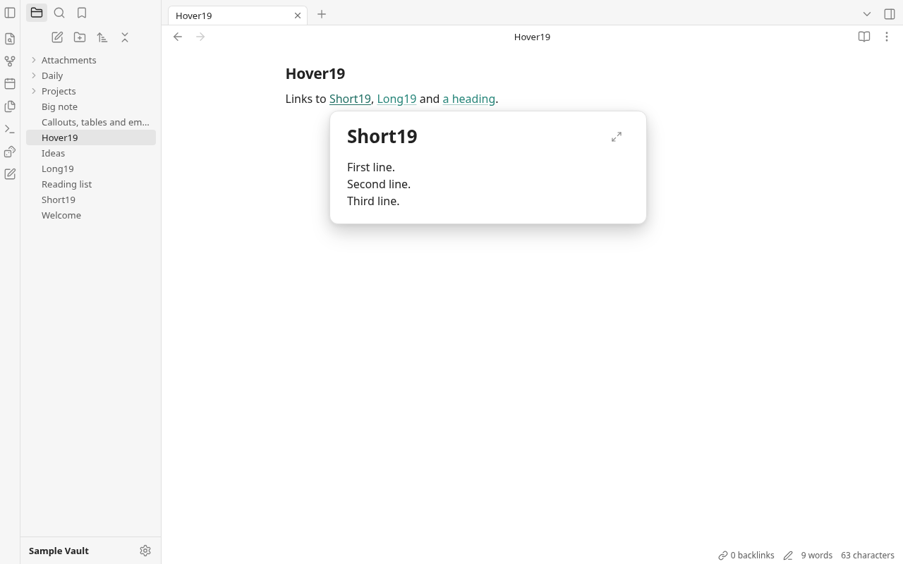
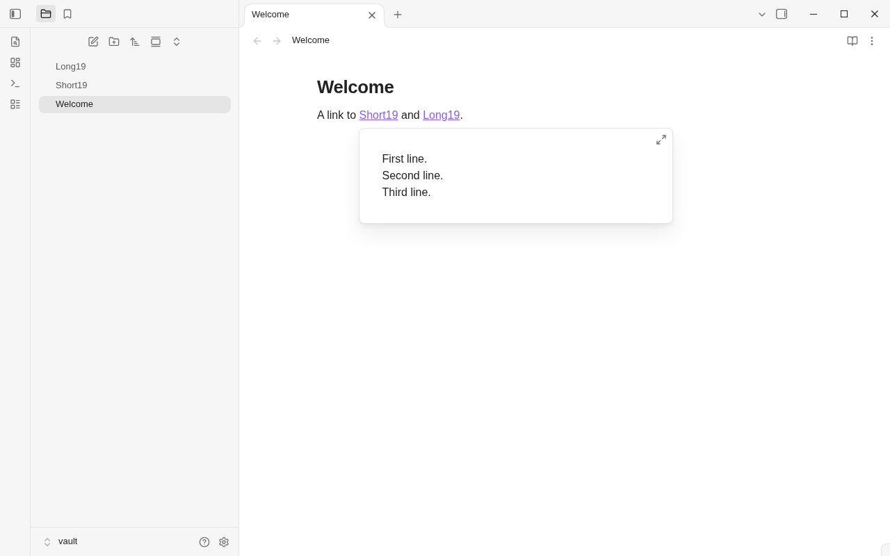

# Round 19 — Part A cleanup

Branch: `rebuild/r19-codex`. Baseline: `245c6c4`.
Part A only. All commits are local; nothing was pushed or merged.

Production TypeScript and CSS are **106 lines smaller**. This falls short of
the brief's 300-line aim. The remaining hover, find, embed and table paths
were reviewed, but their similar-looking branches have different selection,
modifier, task and source-position behavior. They were retained rather than
changing that behavior or adding an abstraction to meet a line count.

## Cuts and reasons

- **`e3edc79` — 22 production TS lines saved.** Extend the existing
  `sideView.ts` helpers with shared result groups and match rows. Search and
  Backlinks now use the same DOM construction, preview-path attribute,
  original-column selection and snippet highlighting. Their different title
  click modifiers, pagination, counts and empty-group handling remain at the
  call sites. The old duplicate builders were deleted.
- **`54ac1c2` — 6 production TS lines saved; 7 test lines added.** The eager
  `unlinkedMentions` wrapper had no production caller: `rg` and a scan of
  exported names against other production modules found only its definition
  and `unlinked.test.ts`. Move that convenience wrapper into its test;
  production continues using the existing sliced `scanUnlinked` generator.
  Remove 30 unnecessary export modifiers from module-local types and settings
  constants (no line reduction from those modifiers). Cross-module reference
  checks and the strict TypeScript build confirm no consumers were removed.
- **`feb6e3f` — 39 CSS lines saved.** Merge identical renderer visibility,
  positioning, hover, weight and cursor rules; share Source/Live Preview
  emphasis rules; combine the two code-block rules. Remove the inline-code
  marker's inherited font, a bullet's default zero margin, a graph heading's
  inherited size, the graph panel's default absent shadow and its unused
  row-pseudo-element override. Graph rows have no `.setting-items` ancestor,
  so the separator rule never generates their `::before` content. All
  original selector specificities are retained. Visibility checks include
  collapsed callouts, image controls, embeds and the find bar.
- **`ec31e8d` — 28 production TS lines saved.** Register Random note,
  Bookmark all tabs, Insert template and Add file property through the
  existing `pluginAction`/`conditionalAction` factories. Delete the repeated
  plugin, icon, availability and hotkey object construction; retain their
  callbacks and conditions.
- **`f29cbce` — 11 production TS lines saved.** Express the DOM helper's
  optional string attributes with one `Partial<Record<…>>`. Keep the same
  allowed names and value types, including the restricted spellcheck and
  contenteditable values and data/ARIA/event signatures. No runtime change.

The narrowed exports, grouped by module, are:

- `api`: VaultChange; `noteEditors`: EditorEvents; `tabs`: TabMemory.
- Editor `editor`: NoteStateOptions; `host`: LinkTarget; `linkAt`: LinkAt;
  `syntax`: MarkerStyles.
- Graph `data`: GraphSource, GraphOptions; `draw`: GraphFrame; `input`:
  GraphGestures, GraphInput; `panel`: PanelHost; `view`: GraphHost.
- Settings `controls`: RowOptions, TextOptions; `exclude`: ExcludeTest;
  `plugins`: CorePlugin; `schema`: DAILY_NOTES, TEMPLATES, BACKLINK,
  NOTE_COMPOSER.
- Shell `confirm`: ConfirmOptions; `fuzzy`: FuzzyMatch; `menu`: MenuAnchor,
  MenuOptions; `menus`: MenuHost; `paletteItems`: PaletteItem; `pane`:
  PaneExtras; `suggest`: SuggestOptions.

No further CSS selector or runtime flag was proven wholly unused. Dynamic names
were checked as well as literal references: for example, quote/cite callouts
use `--color-gray` through `--color-${kind.color}`, so that token stays.
Table source offsets also stay calculated from current text; replacing them
with existing DOM offsets would risk using stale positions after cell edits.
No table, editor-update or ordinary typing work was added.

## Before/after visual check

Vite and headless Chromium, private browser profile, 1280×800, scale 1,
fresh browser storage and the in-memory mock vault. The final comparison
serves baseline source extracted from `245c6c4` inside this worktree's ignored
`rebuild/app/dist/.round19-baseline/`, then the final source, with existing
transitions allowed to settle. Captures use native CDP
pointer movement and keyboard input. The hover capture uses Ctrl+hover and
moves into the preview; find/search fields use native mouse press/release.
No DOM `.click()` calls were used by the harness.

**All five required before/after screenshots match exactly: zero differing
pixels**, measured with ImageMagick `compare -metric AE` after the final
code changes. The linked pairs are committed with these notes:

- Welcome: [before](round19-shots/before-welcome.png), [after](round19-shots/after-welcome.png).
- Callouts/tables/embeds: [before](round19-shots/before-blocks.png), [after](round19-shots/after-blocks.png).
- Search: [before](round19-shots/before-search.png), [after](round19-shots/after-search.png).
- Find bar: [before](round19-shots/before-find.png), [after](round19-shots/after-find.png).
- Hover preview: [before](round19-shots/before-hover.png), [after](round19-shots/after-hover.png).

Additional CSS checks compare original styles from `245c6c4` with the final
styles in the same fixture: Source headings with emphasis, Reading view,
dark Reading view (including a cite callout and code block), and Settings.
All four additional screenshot pairs also have zero differing pixels.
Visible-element computed styles and geometry agree, apart from tiny sampling
differences during the sidebar button's existing hover-opacity transition.
Harnesses, style snapshots and supplemental captures remain ignored under
`rebuild/app/node_modules/.round19/` (`capture.mjs`, `style-check.mjs`).
No visible application window or Tauri app was launched. No owner's vault
was read or modified. WebKitGTK was not exercised.

## Verification

Final required gates passed:

- `npm run build`.
- `npm test`: **198 tests in 38 files**, unchanged test count.
- `npm run audit:offline`: source, release output, CSP, capabilities and
  dependency audit passed.
- `cargo build` and `cargo test`: **32 Rust tests** passed.
- `git diff --check`.

`node scripts/test-round18.mjs` passed all **43 native-input browser
assertions**, covering find/replace, tag clicks and drags, Search/Backlinks
selection, hover placement/lifetime/section scrolling, embed source clicks,
task toggling, embedded links and Reading heading styles. One attempt while
Cargo was doing its cold build reached the harness's fixed startup timeout
before `window.ws` existed; a later complete run passed, and no application
startup behavior was changed. No speedup is claimed; no new per-keystroke work or
new dependency was introduced.

## Net tracked app lines

The task's newline-count convention, under `rebuild/app`, excluding `/gen/`:

- Production TypeScript: **19,121 → 19,054 (−67)**.
- TypeScript tests: **2,742 → 2,749 (+7)**, from moving the test helper.
- TypeScript total: **21,863 → 21,803 (−60)**.
- CSS: **3,698 → 3,659 (−39)**.
- Rust: **3,104 → 3,104 (0)**.
- TS/CSS/Rust total: **28,665 → 28,566 (−99)**.
- JavaScript (`.mjs`, counted separately): **530 → 530 (0)**.
- Production TS plus CSS: **22,819 → 22,713 (−106)**.

The largest production file remains `src/shell/pane.ts` at **649 lines**;
no source file approaches 800 lines. These counts exclude this notes file
and screenshot artifacts. Part B is untouched. Stop here and await Part B.

# Part B — four requested fixes

Baseline: accepted Part A, `6cdd27c`. Same worktree and branch; local commits
only. Each fix includes its regression tests.

1. **Preview title and size — `4890184`.** Reuse the existing note embed's
   title and Open link control. Show a large file title even for a heading
   target, replace the fixed popup height with a 400px maximum, and let
   short notes shrink. A ResizeObserver exists only while the popup is open
   and reuses its placement calculation when asynchronous content changes
   its height. Closing disconnects it. Native-input tests verify the title,
   short/long sizes, Open link navigation, heading alignment and constrained
   viewport bounds. The existing hover timing tests still pass.
2. **Rename errors — `b17536c`.** Stop removing invalid characters from
   names. Reject invalid/empty names and retain the existing case-insensitive
   clash check. The inline title and explorer use a shared error element
   beneath the field, with `role=alert` and `aria-invalid`. Failed explorer
   renames remain editable; correction or Escape clears the error. Keep the
   original draft on failure instead of reverting it silently. File-operation
   tests cover invalid names without backend writes, clashes, Unicode,
   case-only changes and folders. Native-input tests cover both fields,
   Enter and blur, empty/invalid/clashing names, correction and title Escape.
3. **Ordered-list numbering — `f601500`.** Wrap the existing indent commands
   and renumber only their affected list trees. Keep the old parent and
   existing sublist starting numbers; a newly indented sublist starts at 1.
   Outdenting also renumbers the remaining sublist. Match the observed
   four-space minimum for list indentation with smaller text-indent settings.
   Compose indentation and number changes into one transaction, preserving
   selections and one-step Undo. Tab/Shift+Tab and the existing indent menu
   commands share this helper. Tests cover tabs/spaces, multi-line selections,
   multi-digit numbers, custom starts, existing sublists, outdenting a first
   child, unrelated lists, fenced code, read-only state and Undo. Native Tab,
   Shift+Tab and Undo pass in the editor, including Source mode.
4. **List-start Backspace — `b69ec58`.** At a real list item's text start,
   remove its bullet/number/task marker while retaining the indentation and
   quote prefix. Reuse indentLess at the remaining indent, and the existing
   Markdown/default deletion handlers elsewhere, so the following press
   outdents or joins. The existing Smart lists setting still controls this
   binding. Tests cover bullet kinds, ordered delimiters, tasks, quotes,
   nesting, the second press, selection/interior deletion and fenced/indented
   code. Native Backspace tests cover bullets, numbers and checked tasks,
   outdenting, joining and list-looking fenced code.

No production module, dependency, backend command or permission was added.
No document-update listener, transaction filter or unconditional scan was
added. List syntax work runs only for an explicit indent or Backspace
command; ordinary character input and table-cell typing retain their existing
paths. No typing speedup is claimed.

## Part B validation and observations

All required final gates passed:

- `npm run build`.
- `npm test`: **207 tests in 39 files** (nine additional tests).
- `npm run audit:offline`: source, release output, CSP, capabilities and
  dependencies passed, including its rebuild.
- `cargo build` and `cargo test`: **32 Rust tests** passed.
- `git diff --check`.

`node scripts/test-round19.mjs` passed **29 native-input browser assertions**.
It starts Vite and headless Chromium with private browser storage and uses
only the mock vault. Native mouse movement precedes each mouse press/release, including
context-menu selection and the preview's Open control. Editing uses native
keyboard input; no DOM `.click()` calls occur in the harness. The existing
`node scripts/test-round18.mjs` passed all **43 assertions**, including hover
lifetime, heading/block scrolling, sidebar placement, find/replace, snippet
selection, tag drags, embed actions and Reading typography.
An intermediate run of the unchanged palette performance test measured
2.22ms against its 2ms limit; the complete unmodified rerun passed.

Screenshots were reviewed at 1280×800, scale 1. Grove captures:
[short preview](round19-shots/partb/hover-short.png),
[long preview](round19-shots/partb/hover-long.png),
[title error](round19-shots/partb/rename-title-invalid.png),
[explorer error](round19-shots/partb/rename-explorer-invalid.png),
[list indentation](round19-shots/partb/list-indent.png), and
[marker removed](round19-shots/partb/backspace-marker.png).

Obsidian **1.14.4** was observed with the same short note and list fixtures,
using native CDP pointer and keyboard input. It ran with
`--ozone-platform=headless`, private HOME/XDG/profile directories and a newly
created fixture vault inside this worktree's ignored scratch directory,
inside a network namespace without external connectivity. Only rendered
UI/DOM was inspected; no Obsidian implementation, styles or assets were
copied. No visible application window, Tauri app or owner's vault was opened.
WebKitGTK was not exercised.

The comparison supports the requested shrink-to-fit and expand control,
inline invalid-name error, parent/sublist numbering, retained custom starts,
and four-space minimum list indent. Two differences from the brief were
observed and are recorded rather than claiming exact Obsidian parity:

- The three-line Obsidian preview measured **452×138**, with an expand icon
  and no file-title heading. Grove implements the large file title explicitly
  requested here, retains its 450px width, shrinks below 250px for that note,
  and caps long notes at 400px. Grove (left), Obsidian (right):

  
  

- In the isolated Obsidian configuration, Backspace at the text start in
  Live Preview deleted syntax one character at a time: `1. nested` became
  `1.nested`. DOM selection inspection confirmed the caret at offset zero
  in `nested`. Grove implements the owner's explicit two-stage target:
  remove the whole marker, then outdent/join. Compare
  [Grove](round19-shots/partb/backspace-marker.png) with
  [observed Obsidian](round19-shots/partb/obsidian-backspace-marker.png).

Other reference captures: [Obsidian rename error](round19-shots/partb/obsidian-rename-invalid.png)
and [Obsidian ordered-list indentation](round19-shots/partb/obsidian-list-indent.png).
The observation harness/log and private fixtures remain ignored under
`rebuild/app/node_modules/.round19b/`; Grove captures are also retained under
`rebuild/app/node_modules/.round19-partb/`.

## Final line counts after Part B

Same tracked-file/newline convention under `rebuild/app`, excluding `/gen/`,
notes and screenshots. Part B deltas compare accepted Part A (`6cdd27c`):

- Production TypeScript: **19,054 → 19,176 (+122)**.
- TypeScript tests: **2,749 → 2,845 (+96)**.
- TypeScript total: **21,803 → 22,021 (+218)**.
- CSS: **3,659 → 3,680 (+21)**.
- Rust: **3,104 → 3,104 (0)**.
- TS/CSS/Rust total: **28,566 → 28,805 (+239)**.
- JavaScript (`.mjs`, separate): **530 → 683 (+153)**, all in the new
  headless regression harness. Including it, Part B is **+392** lines.

Across all of round 19 from `245c6c4`: production TS **+55**, TS tests
**+103**, TS total **+158**, CSS **−18**, Rust **0**, JavaScript **+153**.
The brief's total is **+140**; including JavaScript, **+293**.
Production TS plus CSS is **+37** for the complete round. The largest
production file is `pane.ts`, **658 lines**; all remain below 800.
No push or merge was performed. Part B is complete; stop here.
