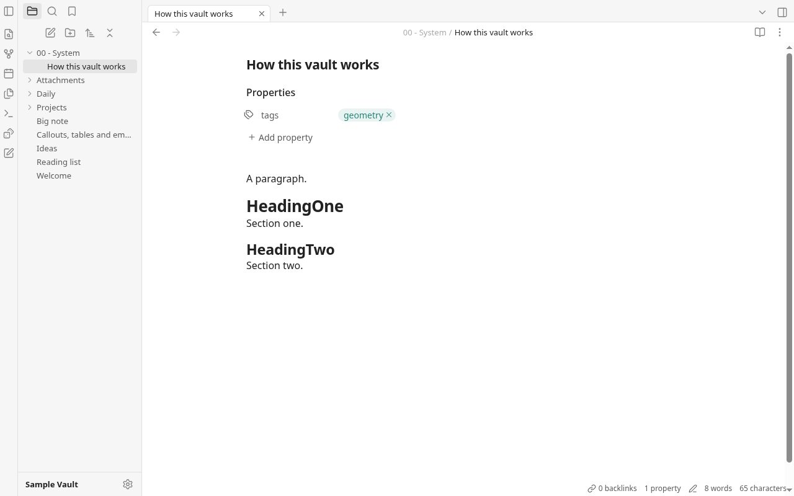
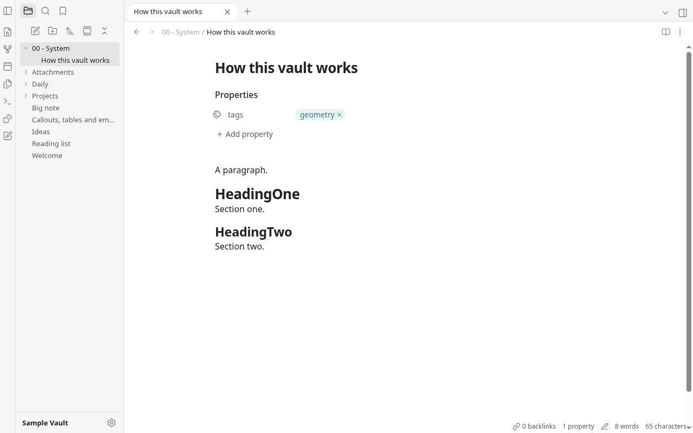
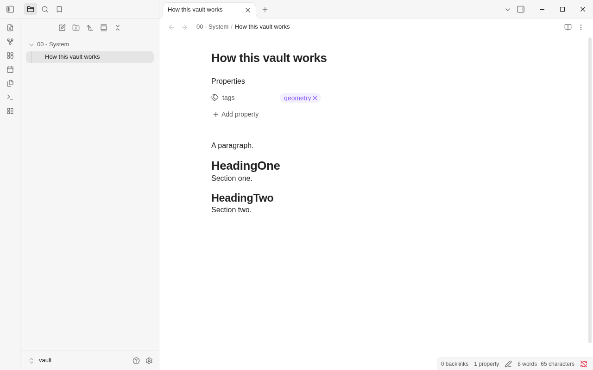

# Round 20 — Chris fixes and Part A

Worktree `grove-r20-codex`, branch `rebuild/r20-codex`. App baseline
`45f7fba` (the supplied brief; app counts agree with round 19). Local commits
only; no push or merge. Part B is untouched.

## Changes, in requested order

- **`b41d19c` — stationary fold arrows.** Reposition the existing hover
  chevron after a fold-state change when the pointer remains inside the
  editor. Record moves over the chevron too. Reserve the note scroller's
  scrollbar gutter: otherwise collapsing a frontmatter note can remove its
  scrollbar, shift the centered column 7.5px, and make the second click miss
  the replacement folded marker. No document scan was added. The permanent
  geometry suite now clicks the arrow twice at identical coordinates,
  without an intervening mouse move, on H1/H2/H3 in all three modes, with
  and without frontmatter. It also measures geometry after unfolding.
- **`0fa1167` — tab bar and view header.** Match the observed taller tab,
  rounded active-tab top, close-button size, plus-button spacing, header
  height and inline-title size. The breadcrumb renderer already existed;
  its text was centered far from the arrows. Align it beside them and keep
  the controls from shrinking. Bound the note sizer to its column. The
  inline title previously resolved its heading size against the 13px UI
  font; it now uses the configured note font size. The missing toolbar
  control is **Auto-reveal current file** (Lucide `gallery-vertical`), an
  offline toggle reusing `reveal`/`expandTo`; its state is session-local.
- **`70c0542` — move safety and collisions.** Current-parent and
  self/descendant moves are silent no-ops. `relocate` independently checks
  the destination parent with `isUnder`. Collision naming reuses
  `freeName(..., true)`, preserving file extensions and numbering folders
  too. Rename's existing collision errors and case-only renames remain.
- **`55dfb17` — explorer pointer dragging.** Reuse `THRESHOLD` and the tab
  ghost from `tabDrag.ts`, and extend `dragPointer` with cancellation,
  pointer-id filtering and deferred capture. Clicks still open/toggle rows;
  a drag captures to the list so its eventual click opens neither row.
  A 133-line `treeDrag.ts` handles the destination, second ghost line,
  whole-folder/root highlight, hover timer and edge scrolling. Measure rows
  once at drag start and again only after structural auto-expansion;
  scrolling uses stored content coordinates plus the scroll offset.
  Auto-expansion calls the existing `toggleFolder` without its opening
  animation. Expanded folders stay open after drop/cancellation. The ghost
  and highlight have no opening animation. Escape, native pointercancel,
  blur and tree rerenders clean up the drag. No idle or typing loop runs.
- **`4eb7777` — additional cancellation coverage.** Native window blur via
  another headless page, native touch cancellation, focus restoration,
  exact before/after window-listener comparisons, directory collisions,
  upwards scrolling and Escape during a running scroll loop.

Moves call the existing `moveFile` → `relocate` → editor move /
`followMove` → `fileSettings.renamed` → `updateLinks` path. The browser test
accepts the existing **Update links?** dialog with a native click and checks
`[[DragA/Uniq]]` becomes `[[Uniq]]`, then undoes that rewrite. Frontmatter
notes moved while open in Live Preview, Source and Reading keep their tab
identity, view mode, title, breadcrumb and edit history. Reading remains
read-only; its prior edit is undone after switching back to editing. No
file-move undo, backend command, dependency or permission was added.

## Observation and screenshots

Obsidian **1.14.4**, default light theme, the same frontmatter note and
1280×800 / 900×800 viewport sizes. Observed rendered UI/DOM only; no Obsidian
implementation, styles or assets were copied. Obsidian ran with headless
Ozone, private HOME/XDG/profile directories, a scratch vault inside this
worktree's ignored `node_modules/.round20/`, and a network namespace with
no external connectivity. Grove used Vite and headless Chromium with its
in-memory mock vault. No app window appeared on the owner's screen; no
owner vault was read or modified. Tauri/WebKitGTK was not launched.

Measured Obsidian / Grove before / Grove after:

- Tab strip: **40 / 36 / 40px**; tab row: **34 / 28 / 34px**.
- Tab label: **13 / 13 / 13px**, normal weight in all three; the observation
  did not support increasing its font size. Its line-height is now 1.3.
- Active outer top radius: **10 / 0 / 10px** (Grove previously rounded only
  its inner box at 6px; its inner box now has 4px corners).
- Close control: **20 / 18 / 20px**; plus control width: **24 / 30 / 24px**;
  gap after the tab: **8 / 4 / 8px**.
- View header height: **38.05 / 32 / 38px**.
- Inline title: **25.89 / 21.03 / 25.89px**, weight 700. Its left edge and
  the text column agree within 1px at 1280, 900 and 600px, in every mode;
  long spaced and unbroken rename drafts wrap inside the pane.

The original right-edge clipping did not reproduce in the clean before
profile: the before title was already aligned with its text. Explicit
column bounds and the new native-input narrow-width checks protect that
layout. Grove retains its existing 200px sidebar and font family, versus
Obsidian's observed 300px sidebar; these are not pixel-identical screenshots.
The breadcrumb is now left-aligned; its initial inset from the pane edge
is 70px versus Obsidian's 76px.

1280px comparison, Grove before / after / Obsidian:

900px: [Grove before](round20-shots/grove-before-900.png),
[Grove after](round20-shots/grove-after-900.png),
[Obsidian](round20-shots/obsidian-900.png).

## Measurements and verification

Final complete run:

- `npm run build`: passed.
- `npm test`: **230 unit tests in 41 files**, then all four headless browser
  suites: geometry **187**, round 19 fixes **92**, header **20**, explorer
  dragging **65** named checks, plus their direct assertions.
- Geometry: every rendered line within **1px** of CodeMirror's top and no
  direct content-child vertical margins, including moved frontmatter notes.
  Prompts/menus visible within two frames; longest sampled frame **17.0ms**.
- Auto-expansion: **751.1ms**, measured from trusted pointer entry to the
  chevron's expanded state; still collapsed at **600ms**. Leaving early
  cancels it; Escape after expansion leaves it open.
- Downward edge speeds over 500ms: **240.0px/s at 39px**, **478.7px/s at
  25px**, **1,616.4px/s at 10px**. Upward scrolling passes too. Scrolling
  stops outside the edge zone and on cancellation. Only one continuous
  animation-frame loop exists while scrolling can advance.
- Native drag cases cover file → collapsed folder, folder → folder,
  file-row → parent, empty-space → root, own parent, refused descendants,
  file collision `A1 1.md`, directory collision carrying children, early
  hover exit, Escape, blur, pointercancel, listener cleanup and focus.
- `npm run audit:offline`: passed; **129** source files, release output,
  CSP, capabilities and dependencies checked.
- `cargo build` and `cargo test`: passed; **32 Rust tests**.
- `git diff --check`: passed. Largest production file remains `pane.ts`,
  **664 lines**. Ordinary typing and table editing gain no drag listener,
  document scan or transaction handler; no typing speedup is claimed.

All pointer interactions in the browser suites use native CDP input, moving
onto a control before pressing. The stationary unfold checks deliberately
omit movement between clicks. Pointercancel uses native CDP touch events.
Test setup uses only scratch/mock data. Folder collision behavior is tested
in Grove; it was **not independently confirmed in Obsidian** this round.

## Net tracked app lines

Same newline convention under `rebuild/app`, excluding `/gen/`, notes and
screenshots. Compared with the supplied app baseline:

- Production TypeScript: **19,261 → 19,431 (+170)**.
- TypeScript tests: **2,969 → 3,047 (+78)**.
- TypeScript total: **22,230 → 22,478 (+248)**.
- CSS: **3,676 → 3,726 (+50)**.
- Rust: **3,104 → 3,104 (0)**.
- TS/CSS/Rust total: **29,010 → 29,308 (+298)**.
- JavaScript (`.mjs`, tests/tools): **1,056 → 1,325 (+269)**.
- JSON: **+2 lines**, test script wiring. Total including mjs/JSON: **+569**.
  Production TS/CSS/Rust together: **+220**.

Part B's background-tab activation, global Windows scrollbars and browser
executable discovery are deferred exactly as requested. No Part A item is
deferred; the observational limitations are recorded above.

Next improvements:

- Drag explorer rows into notes to insert links; reuse this drag and reduce menu work; medium.
- Explorer multi-selection; move groups of notes together; medium.
- Convert rich-text paste to Markdown; preserve copied formatting; medium.

Part A complete. Stop here and await Part B.
